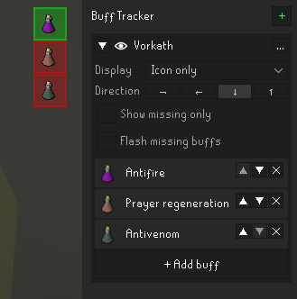

# Buff Tracker

Put buffs such as potions and thralls into groups and see at a glance which ones are missing.  

## Usage

1. In the sidepanel, click **+** to create a group.
2. Expand the group and use **+ Add buff** to pick buffs for it.
3. Use the eye icon to choose which group is shown. The overlay can be moved like any other overlay by holding Alt.

Present buffs are highlighted green and missing ones red. Each group can be set to **Show missing only**, hiding
buffs that are active, and to **Flash missing buffs**.  
Groups can be cycled and toggled with hotkeys. Only one group may be visible at a time.

## Tracked buffs

Potions:
* stamina
* antipoison
* antivenom
* antifire
* super antifire
* menaphite remedy
* divine potions
* moonlight potion
* goading potion
* prayer regeneration
* surge potion
* overload (Nightmare Zone, Chambers of Xeric and Deadman)

Spells:
* thralls
* shadow veil
* death charge
* vengeance

